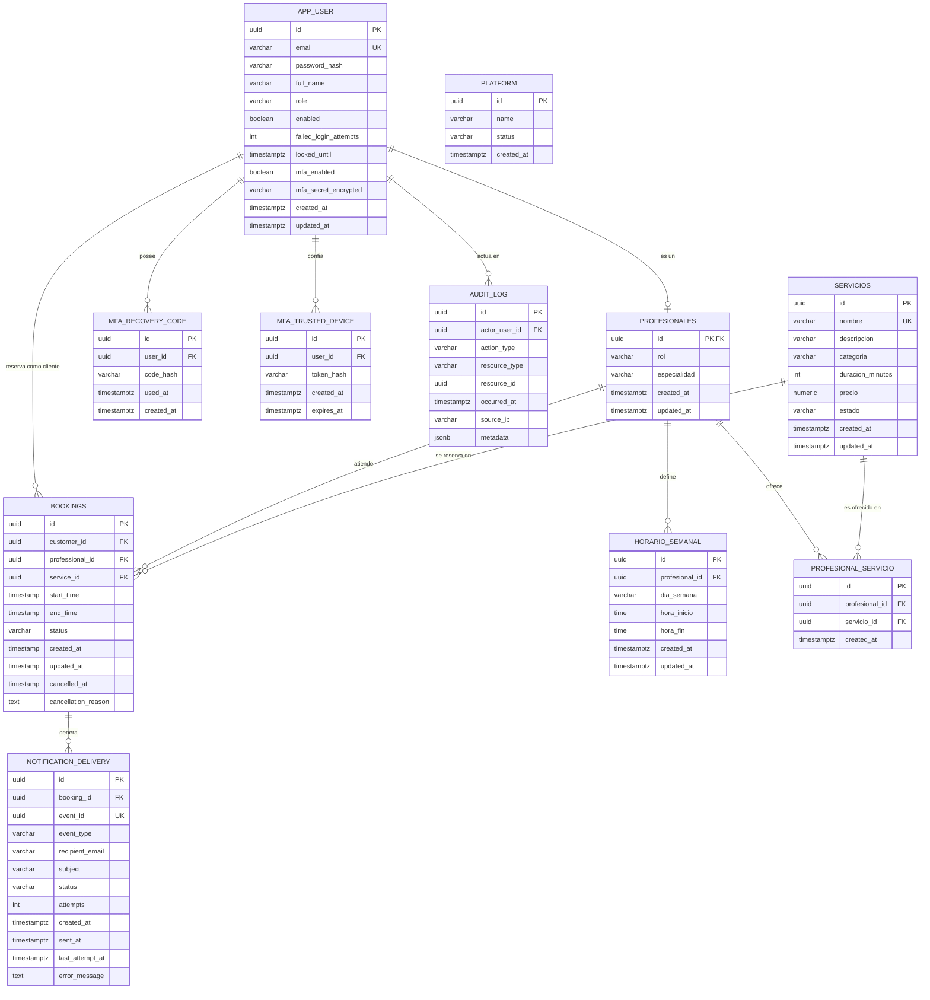

# Bookly · Plataforma de reservas de servicios

**Sprint 2 · Diseño de Base de Datos · Facultad de Ingeniería**
Proyecto backend: `backendcf` (CodeFactory EAV10). Motor: PostgreSQL 16 / Supabase.

Bookly permite que clientes reserven servicios con profesionales de negocios como clínicas, salones o centros deportivos. Este sprint extiende el modelo del Sprint 1 (cuentas, plataforma, servicios y profesionales) con horarios, reservas, notificaciones, auditoría y segundo factor de autenticación.

## Contenido del repositorio

| Archivo | Qué contiene |
|---|---|
| `README.md` | Este documento: MER, modelo físico, consultas, volumen, roles y seguridad |
| `schema.sql` | Estructuras: tablas, claves, restricciones e índices (PostgreSQL / Supabase) |
| `security.sql` | Roles y privilegios (`CREATE ROLE`, `GRANT`, `REVOKE`) |
| `security_rls.sql` | Row Level Security y políticas (solo Supabase) |
| `docs/analisis-almacenamiento.md` | Almacenamiento e índices, costo de una consulta y optimización algebraica |

## Cómo ejecutar los scripts

Sobre una base PostgreSQL o Supabase **vacía**, en este orden:

1. `schema.sql`: crea las 11 tablas en orden de dependencias (requiere la extensión `btree_gist`, que Supabase incluye).
2. `security.sql`: crea los roles y asigna los privilegios.
3. `security_rls.sql`: activa RLS. **Solo en Supabase**, porque usa `auth.uid()` y los roles `anon` y `authenticated`.

## Tabla de contenido

1. [MER refinado](#mer-refinado)
2. [Modelo físico](#modelo-físico)
3. [Normalización](#normalización-3fn)
4. [Consultas SQL](#consultas-sql)
5. [Estimación de volumen](#estimación-de-volumen)
6. [Roles y esquema de seguridad](#roles-y-esquema-de-seguridad)
7. [Análisis de almacenamiento, costo y optimización](#análisis-de-almacenamiento-costo-y-optimización)

---

## MER refinado

Modelo entidad-relación del Sprint 2. Las claves se marcan como `PK` (primaria), `FK` (foránea) y `UK` (única). La tabla técnica `flyway_schema_history`, que genera Flyway para controlar las migraciones, no forma parte del modelo de negocio.



**Cardinalidades.** Una cuenta puede tener 0 o 1 perfil profesional; un profesional puede tener muchos horarios y reservas; un servicio puede aparecer en muchas reservas; la relación N:M entre profesionales y servicios se resuelve con `PROFESIONAL_SERVICIO`; una reserva puede generar varias notificaciones. `PLATFORM` no se relaciona con otras tablas: es una configuración única.

### Cambios frente al Sprint 1

El Sprint 1 tenía 4 tablas (`app_user`, `platform`, `servicios`, `profesionales`). El Sprint 2 las conserva y suma 7 tablas y 2 columnas.

| Cambio | Tipo | Motivo |
|---|---|---|
| `app_user`: columnas `mfa_enabled` y `mfa_secret_encrypted` | Atributos nuevos | HU-18: segundo factor TOTP para administradores |
| `horario_semanal` | Entidad nueva (1:N con `profesionales`) | HU-04: horario semanal del profesional |
| `profesional_servicio` | Entidad asociativa nueva | HU-07 y HU-08: resuelve la relación N:M entre profesionales y servicios |
| `bookings` | Entidad nueva | HU-08 y HU-09: reservas y cancelación |
| `notification_delivery` | Entidad nueva (1:N con `bookings`) | HU-10: correos de confirmación y cancelación |
| `audit_log` | Entidad nueva | HU-19: bitácora inmutable de acciones críticas |
| `mfa_recovery_code` | Entidad nueva (1:N con `app_user`) | HU-18: códigos de respaldo |
| `mfa_trusted_device` | Entidad nueva (1:N con `app_user`) | HU-18: dispositivos de confianza |
| `platform`, `servicios`, `profesionales` | Sin cambios estructurales | Se mantienen del Sprint 1 |

HU-17 (roles y permisos) no necesitó tablas nuevas: reutiliza `app_user.role`.

---

## Modelo físico

Generado a partir de `schema.sql` ejecutado sobre PostgreSQL 16, de modo que coincide con el script. Los tipos, `NOT NULL`, `DEFAULT`, claves y restricciones son los reales de la base.

### `app_user`

Cuentas de la plataforma (hub central). El rol distingue CUSTOMER, PROFESSIONAL y ADMIN. Incluye seguridad de login y segundo factor (HU-01, HU-03, HU-18).

| Columna | Tipo | Nulo | Valor por defecto |
|---|---|---|---|
| `id` | UUID | NOT NULL | — |
| `email` | VARCHAR(320) | NOT NULL | — |
| `password_hash` | VARCHAR(255) | NOT NULL | — |
| `full_name` | VARCHAR(150) | NOT NULL | — |
| `role` | VARCHAR(30) | NOT NULL | — |
| `enabled` | BOOLEAN | NOT NULL | `true` |
| `failed_login_attempts` | INTEGER | NOT NULL | `0` |
| `locked_until` | TIMESTAMPTZ | NULL | — |
| `created_at` | TIMESTAMPTZ | NOT NULL | `now()` |
| `updated_at` | TIMESTAMPTZ | NOT NULL | `now()` |
| `mfa_enabled` | BOOLEAN | NOT NULL | `false` |
| `mfa_secret_encrypted` | VARCHAR(512) | NULL | — |

**Restricciones**

- **PK** `pk_app_user`: `PRIMARY KEY (id)`
- **UNIQUE** `uk_app_user_email`: `UNIQUE (email)`
- **UNIQUE** `uk_app_user_id_role`: `UNIQUE (id, role)`
- **CHECK** `ck_app_user_role`: `CHECK (role IN ('CUSTOMER', 'PROFESSIONAL', 'ADMIN'))`

### `platform`

Configuración única de la plataforma (HU-20). Un índice sobre la expresión constante `true` limita la tabla a una sola fila.

| Columna | Tipo | Nulo | Valor por defecto |
|---|---|---|---|
| `id` | UUID | NOT NULL | — |
| `name` | VARCHAR(150) | NOT NULL | — |
| `status` | VARCHAR(20) | NOT NULL | — |
| `created_at` | TIMESTAMPTZ | NOT NULL | `now()` |

**Restricciones**

- **PK** `pk_platform`: `PRIMARY KEY (id)`
- **CHECK** `ck_platform_status`: `CHECK (status IN ('ACTIVE', 'SUSPENDED'))`

**Índices**

- `uk_platform_singleton`: `UNIQUE INDEX uk_platform_singleton ON platform USING btree ((true))`

### `servicios`

Catálogo de servicios (HU-02, HU-06).

| Columna | Tipo | Nulo | Valor por defecto |
|---|---|---|---|
| `id` | UUID | NOT NULL | — |
| `nombre` | VARCHAR(150) | NOT NULL | — |
| `descripcion` | VARCHAR(500) | NULL | — |
| `categoria` | VARCHAR(100) | NOT NULL | — |
| `duracion_minutos` | INTEGER | NOT NULL | — |
| `precio` | NUMERIC(12,2) | NOT NULL | — |
| `estado` | VARCHAR(20) | NOT NULL | — |
| `created_at` | TIMESTAMPTZ | NOT NULL | `now()` |
| `updated_at` | TIMESTAMPTZ | NOT NULL | `now()` |

**Restricciones**

- **PK** `pk_servicios`: `PRIMARY KEY (id)`
- **CHECK** `ck_servicios_duracion`: `CHECK ((duracion_minutos > 0) AND (duracion_minutos <= 480))`
- **CHECK** `ck_servicios_estado`: `CHECK (estado IN ('ACTIVO', 'INACTIVO'))`
- **CHECK** `ck_servicios_precio`: `CHECK (precio > 0)`

**Índices**

- `uk_servicios_nombre`: `UNIQUE INDEX uk_servicios_nombre ON servicios USING btree (lower(nombre))`

### `profesionales`

Perfil que extiende a `app_user` (relación 1:0..1). Comparte la clave primaria con la cuenta (HU-22).

| Columna | Tipo | Nulo | Valor por defecto |
|---|---|---|---|
| `id` | UUID | NOT NULL | — |
| `rol` | VARCHAR(30) | NOT NULL | `'PROFESSIONAL'` |
| `especialidad` | VARCHAR(150) | NOT NULL | — |
| `created_at` | TIMESTAMPTZ | NOT NULL | `now()` |
| `updated_at` | TIMESTAMPTZ | NOT NULL | `now()` |

**Restricciones**

- **PK** `pk_profesionales`: `PRIMARY KEY (id)`
- **FK** `fk_profesionales_app_user`: `FOREIGN KEY (id, rol) REFERENCES app_user(id, role)`
- **CHECK** `ck_profesionales_rol`: `CHECK (rol = 'PROFESSIONAL')`

### `horario_semanal`

Franjas semanales de atención de cada profesional (HU-04).

| Columna | Tipo | Nulo | Valor por defecto |
|---|---|---|---|
| `id` | UUID | NOT NULL | — |
| `profesional_id` | UUID | NOT NULL | — |
| `dia_semana` | VARCHAR(10) | NOT NULL | — |
| `hora_inicio` | TIME | NOT NULL | — |
| `hora_fin` | TIME | NOT NULL | — |
| `created_at` | TIMESTAMPTZ | NOT NULL | — |
| `updated_at` | TIMESTAMPTZ | NOT NULL | — |

**Restricciones**

- **PK** `pk_horario_semanal`: `PRIMARY KEY (id)`
- **UNIQUE** `uk_horario_semanal_inicio`: `UNIQUE (profesional_id, dia_semana, hora_inicio)`
- **FK** `fk_horario_semanal_profesional`: `FOREIGN KEY (profesional_id) REFERENCES profesionales(id)`
- **CHECK** `ck_horario_semanal_dia`: `CHECK (dia_semana IN ('MONDAY', 'TUESDAY', 'WEDNESDAY', 'THURSDAY', 'FRIDAY', 'SATURDAY', 'SUNDAY'))`
- **CHECK** `ck_horario_semanal_franja`: `CHECK (hora_fin > hora_inicio)`

**Índices**

- `ix_horario_semanal_profesional`: `INDEX ix_horario_semanal_profesional ON horario_semanal USING btree (profesional_id)`

### `profesional_servicio`

Tabla asociativa de la relación N:M entre profesionales y servicios (HU-07, HU-08).

| Columna | Tipo | Nulo | Valor por defecto |
|---|---|---|---|
| `id` | UUID | NOT NULL | — |
| `profesional_id` | UUID | NOT NULL | — |
| `servicio_id` | UUID | NOT NULL | — |
| `created_at` | TIMESTAMPTZ | NOT NULL | — |

**Restricciones**

- **PK** `pk_profesional_servicio`: `PRIMARY KEY (id)`
- **UNIQUE** `uk_profesional_servicio`: `UNIQUE (profesional_id, servicio_id)`
- **FK** `fk_profesional_servicio_profesional`: `FOREIGN KEY (profesional_id) REFERENCES profesionales(id)`
- **FK** `fk_profesional_servicio_servicio`: `FOREIGN KEY (servicio_id) REFERENCES servicios(id)`

**Índices**

- `ix_profesional_servicio_servicio`: `INDEX ix_profesional_servicio_servicio ON profesional_servicio USING btree (servicio_id)`

### `bookings`

Reservas de los clientes (HU-08, HU-09).

| Columna | Tipo | Nulo | Valor por defecto |
|---|---|---|---|
| `id` | UUID | NOT NULL | `gen_random_uuid()` |
| `customer_id` | UUID | NOT NULL | — |
| `professional_id` | UUID | NOT NULL | — |
| `service_id` | UUID | NOT NULL | — |
| `start_time` | TIMESTAMP | NOT NULL | — |
| `end_time` | TIMESTAMP | NOT NULL | — |
| `status` | VARCHAR(50) | NOT NULL | `'CONFIRMADA'` |
| `created_at` | TIMESTAMP | NOT NULL | `CURRENT_TIMESTAMP` |
| `updated_at` | TIMESTAMP | NOT NULL | `CURRENT_TIMESTAMP` |
| `cancelled_at` | TIMESTAMP | NULL | — |
| `cancellation_reason` | TEXT | NULL | — |

**Restricciones**

- **PK** `bookings_pkey`: `PRIMARY KEY (id)`
- **FK** `fk_bookings_customer`: `FOREIGN KEY (customer_id) REFERENCES app_user(id)`
- **FK** `fk_bookings_professional`: `FOREIGN KEY (professional_id) REFERENCES profesionales(id)`
- **FK** `fk_bookings_service`: `FOREIGN KEY (service_id) REFERENCES servicios(id)`
- **CHECK** `booking_time_validity`: `CHECK (start_time < end_time)`
- **CHECK** `bookings_status_check`: `CHECK (status IN ('CONFIRMADA', 'CANCELADA', 'RESCHEDULED', 'COMPLETED'))`
- **EXCLUDE** `booking_no_overlapping_confirmed`: `EXCLUDE USING gist (professional_id WITH =, tsrange(start_time, end_time, '[)') WITH &&) WHERE ((status = 'CONFIRMADA'))`

**Índices**

- `unique_booking_per_professional_time`: `UNIQUE INDEX unique_booking_per_professional_time ON bookings USING btree (professional_id, start_time, end_time) WHERE (status = 'CONFIRMADA')`
- `idx_bookings_customer`: `INDEX idx_bookings_customer ON bookings USING btree (customer_id)`
- `idx_bookings_professional`: `INDEX idx_bookings_professional ON bookings USING btree (professional_id)`
- `idx_bookings_professional_start`: `INDEX idx_bookings_professional_start ON bookings USING btree (professional_id, start_time DESC)`
- `idx_bookings_status`: `INDEX idx_bookings_status ON bookings USING btree (status)`
- `idx_bookings_start_time`: `INDEX idx_bookings_start_time ON bookings USING btree (start_time)`

### `notification_delivery`

Registro técnico e idempotente de correos de reserva (HU-10).

| Columna | Tipo | Nulo | Valor por defecto |
|---|---|---|---|
| `id` | UUID | NOT NULL | `gen_random_uuid()` |
| `event_id` | UUID | NOT NULL | — |
| `booking_id` | UUID | NOT NULL | — |
| `event_type` | VARCHAR(40) | NOT NULL | — |
| `recipient_email` | VARCHAR(320) | NOT NULL | — |
| `subject` | VARCHAR(200) | NOT NULL | — |
| `status` | VARCHAR(20) | NOT NULL | `'PENDING'` |
| `attempts` | INTEGER | NOT NULL | `0` |
| `created_at` | TIMESTAMPTZ | NOT NULL | `CURRENT_TIMESTAMP` |
| `sent_at` | TIMESTAMPTZ | NULL | — |
| `last_attempt_at` | TIMESTAMPTZ | NULL | — |
| `error_message` | TEXT | NULL | — |

**Restricciones**

- **PK** `pk_notification_delivery`: `PRIMARY KEY (id)`
- **UNIQUE** `uk_notification_delivery_event`: `UNIQUE (event_id)`
- **FK** `fk_notification_delivery_booking`: `FOREIGN KEY (booking_id) REFERENCES bookings(id) ON DELETE CASCADE`
- **CHECK** `ck_notification_delivery_attempts`: `CHECK (attempts >= 0)`
- **CHECK** `ck_notification_delivery_event_type`: `CHECK (event_type IN ('BOOKING_CREATED', 'BOOKING_RESCHEDULED', 'BOOKING_CANCELLED'))`
- **CHECK** `ck_notification_delivery_failed_error`: `CHECK ((status <> 'FAILED') OR (error_message IS NOT NULL))`
- **CHECK** `ck_notification_delivery_sent_at`: `CHECK (((status = 'SENT') AND (sent_at IS NOT NULL)) OR ((status <> 'SENT') AND (sent_at IS NULL)))`
- **CHECK** `ck_notification_delivery_status`: `CHECK (status IN ('PENDING', 'SENT', 'FAILED'))`

**Índices**

- `ix_notification_delivery_status_attempt`: `INDEX ix_notification_delivery_status_attempt ON notification_delivery USING btree (status, last_attempt_at)`
- `ix_notification_delivery_booking_created`: `INDEX ix_notification_delivery_booking_created ON notification_delivery USING btree (booking_id, created_at DESC)`
- `ix_notification_delivery_type_created`: `INDEX ix_notification_delivery_type_created ON notification_delivery USING btree (event_type, created_at DESC)`

### `audit_log`

Bitácora inmutable de acciones críticas (HU-19). Triggers rechazan UPDATE, DELETE y TRUNCATE.

| Columna | Tipo | Nulo | Valor por defecto |
|---|---|---|---|
| `id` | UUID | NOT NULL | — |
| `actor_user_id` | UUID | NOT NULL | — |
| `action_type` | VARCHAR(40) | NOT NULL | — |
| `resource_type` | VARCHAR(30) | NOT NULL | — |
| `resource_id` | UUID | NULL | — |
| `occurred_at` | TIMESTAMPTZ | NOT NULL | — |
| `source_ip` | VARCHAR(45) | NULL | — |
| `metadata` | JSONB | NOT NULL | `'{}'` |

**Restricciones**

- **PK** `pk_audit_log`: `PRIMARY KEY (id)`
- **FK** `fk_audit_log_actor`: `FOREIGN KEY (actor_user_id) REFERENCES app_user(id)`
- **CHECK** `ck_audit_log_action_type`: `CHECK (action_type IN ('BOOKING_CREATED', 'BOOKING_CANCELLED', 'ROLE_CHANGED'))`
- **CHECK** `ck_audit_log_resource_type`: `CHECK (resource_type IN ('BOOKING', 'USER'))`

**Índices**

- `ix_audit_log_occurred_at_id`: `INDEX ix_audit_log_occurred_at_id ON audit_log USING btree (occurred_at DESC, id DESC)`
- `ix_audit_log_actor_occurred_at`: `INDEX ix_audit_log_actor_occurred_at ON audit_log USING btree (actor_user_id, occurred_at DESC)`

### `mfa_recovery_code`

Códigos de respaldo del segundo factor, guardados como hash (HU-18).

| Columna | Tipo | Nulo | Valor por defecto |
|---|---|---|---|
| `id` | UUID | NOT NULL | — |
| `user_id` | UUID | NOT NULL | — |
| `code_hash` | VARCHAR(255) | NOT NULL | — |
| `used_at` | TIMESTAMPTZ | NULL | — |
| `created_at` | TIMESTAMPTZ | NOT NULL | — |

**Restricciones**

- **PK** `pk_mfa_recovery_code`: `PRIMARY KEY (id)`
- **FK** `fk_mfa_recovery_code_app_user`: `FOREIGN KEY (user_id) REFERENCES app_user(id)`

**Índices**

- `idx_mfa_recovery_code_user`: `INDEX idx_mfa_recovery_code_user ON mfa_recovery_code USING btree (user_id)`

### `mfa_trusted_device`

Dispositivos de confianza para omitir el segundo factor por 30 días (HU-18).

| Columna | Tipo | Nulo | Valor por defecto |
|---|---|---|---|
| `id` | UUID | NOT NULL | — |
| `user_id` | UUID | NOT NULL | — |
| `token_hash` | VARCHAR(255) | NOT NULL | — |
| `created_at` | TIMESTAMPTZ | NOT NULL | — |
| `expires_at` | TIMESTAMPTZ | NOT NULL | — |

**Restricciones**

- **PK** `pk_mfa_trusted_device`: `PRIMARY KEY (id)`
- **FK** `fk_mfa_trusted_device_app_user`: `FOREIGN KEY (user_id) REFERENCES app_user(id)`

**Índices**

- `idx_mfa_trusted_device_user`: `INDEX idx_mfa_trusted_device_user ON mfa_trusted_device USING btree (user_id)`

### Normalización (3FN)

El modelo cumple como mínimo la tercera forma normal: en cada tabla todos los atributos dependen de la clave primaria completa y no existen dependencias transitivas entre atributos no clave.

- Los datos de identidad (correo, nombre, contraseña, rol) viven solo en `app_user`; `profesionales` guarda únicamente la especialidad.
- La relación N:M entre profesionales y servicios está en su propia tabla (`profesional_servicio`) en lugar de repetir listas de servicios.
- `bookings` guarda referencias (`customer_id`, `professional_id`, `service_id`) y no copia datos de las tablas relacionadas.

**Redundancias deliberadas**, que no violan 3FN en la práctica:

| Redundancia | Justificación |
|---|---|
| `profesionales.rol` repite `app_user.role` | Es necesaria para la clave foránea compuesta `(id, rol)`, que impide crear un perfil profesional para una cuenta que no tenga ese rol |
| `notification_delivery.recipient_email` repite el correo del cliente | Conserva el destinatario real del momento del envío, aunque la cuenta cambie de correo después |
| `audit_log.resource_id` sin clave foránea | Apunta a reservas o usuarios según `resource_type`; la bitácora debe conservarse aunque el recurso se elimine |

### Decisiones de diseño heredadas

- **`bookings` usa `TIMESTAMP` y el resto del esquema usa `TIMESTAMPTZ`.** Viene de la migración V30. Se documenta como decisión heredada y es candidata a corrección en el Sprint 3.
- **Nombres en dos idiomas:** `servicios`, `profesionales` y `horario_semanal` (español) conviven con `bookings` y `app_user` (inglés), por herencia de cada sprint.
- **`bookings` evita la doble reserva en la base de datos:** una restricción de exclusión (`booking_no_overlapping_confirmed`) impide que un profesional tenga dos reservas `CONFIRMADA` que se solapen, incluso con solicitudes simultáneas (ADR-006).

---

## Consultas SQL

Todas las consultas se ejecutan sobre las tablas de `schema.sql`. Cada una indica la pregunta de negocio que responde, la historia de usuario (HU) relacionada y el tipo de operación que usa. Los valores entre comillas (UUID, fechas, nombres) son parámetros de ejemplo que se reemplazan en la aplicación.

### Preguntas clave del Sprint 1

**S1-1. ¿Qué servicios activos duran más de 60 minutos?** (HU-02, HU-06) · Filtro + ordenamiento

```sql
SELECT nombre, categoria, duracion_minutos, precio
FROM servicios
WHERE estado = 'ACTIVO' AND duracion_minutos > 60
ORDER BY duracion_minutos DESC;
```

**S1-2. ¿Qué profesionales tienen una especialidad dada?** (HU-22) · Filtro

```sql
SELECT id, especialidad
FROM profesionales
WHERE lower(especialidad) = lower('Fisioterapia');
```

**S1-3. ¿Cuántas cuentas hay por rol?** (HU-01) · Agregación

```sql
SELECT role, COUNT(*) AS cantidad
FROM app_user
GROUP BY role
ORDER BY role;
```

**S1-4. ¿Cuáles son los datos de cuenta y especialidad de cada profesional?** (HU-22) · Join

```sql
SELECT u.id, u.full_name, u.email, p.especialidad
FROM app_user AS u
JOIN profesionales AS p ON p.id = u.id
WHERE u.role = 'PROFESSIONAL';
```

**S1-5. ¿Cuál es el precio promedio de los servicios activos por categoría?** (HU-02) · Agregación + filtro

```sql
SELECT categoria, ROUND(AVG(precio), 2) AS precio_promedio
FROM servicios
WHERE estado = 'ACTIVO'
GROUP BY categoria
ORDER BY categoria;
```

### Preguntas clave del Sprint 2

**S2-1. ¿Cuál es el horario semanal de un profesional?** (HU-04) · Filtro + ordenamiento

```sql
SELECT dia_semana, hora_inicio, hora_fin
FROM horario_semanal
WHERE profesional_id = '00000000-0000-0000-0000-000000000002'
ORDER BY CASE dia_semana
           WHEN 'MONDAY' THEN 1 WHEN 'TUESDAY' THEN 2 WHEN 'WEDNESDAY' THEN 3
           WHEN 'THURSDAY' THEN 4 WHEN 'FRIDAY' THEN 5 WHEN 'SATURDAY' THEN 6
           ELSE 7 END,
         hora_inicio;
```

**S2-2. ¿Qué servicios activos ofrece un profesional?** (HU-07, HU-08) · Join (relación N:M)

```sql
SELECT s.nombre, s.categoria, s.duracion_minutos, s.precio
FROM profesional_servicio ps
JOIN servicios s ON s.id = ps.servicio_id
WHERE ps.profesional_id = '00000000-0000-0000-0000-000000000002'
  AND s.estado = 'ACTIVO'
ORDER BY s.nombre;
```

**S2-3. ¿Qué franjas libres tiene un profesional para un servicio en una fecha?** (HU-07) · Join + subconsulta `NOT EXISTS`

Divide el horario del día en franjas de la duración del servicio y descarta las que se solapan con una reserva CONFIRMADA (la misma regla que aplica la restricción de exclusión de la base).

```sql
SELECT DATE '2026-11-02' + h.hora_inicio
       + (g.n * s.duracion_minutos) * INTERVAL '1 minute' AS inicio_franja
FROM servicios s
JOIN horario_semanal h
  ON h.profesional_id = '00000000-0000-0000-0000-000000000002'
 AND h.dia_semana = (ARRAY['MONDAY','TUESDAY','WEDNESDAY','THURSDAY',
                           'FRIDAY','SATURDAY','SUNDAY'])
                    [EXTRACT(ISODOW FROM DATE '2026-11-02')::int]
CROSS JOIN LATERAL generate_series(0,
    (EXTRACT(EPOCH FROM (h.hora_fin - h.hora_inicio)) / 60)::int
      / s.duracion_minutos - 1) AS g(n)
WHERE s.id = '00000000-0000-0000-0000-0000000000a1'
  AND NOT EXISTS (
    SELECT 1 FROM bookings b
    WHERE b.professional_id = h.profesional_id
      AND b.status = 'CONFIRMADA'
      AND tsrange(b.start_time, b.end_time) &&
          tsrange(DATE '2026-11-02' + h.hora_inicio
                    + (g.n * s.duracion_minutos) * INTERVAL '1 minute',
                  DATE '2026-11-02' + h.hora_inicio
                    + ((g.n + 1) * s.duracion_minutos) * INTERVAL '1 minute'))
ORDER BY inicio_franja;
```

**S2-4. ¿Qué reservas confirmadas tiene un cliente?** (HU-08) · Join de 3 tablas + filtro

```sql
SELECT b.start_time, b.end_time, b.status,
       s.nombre AS servicio, u.full_name AS profesional
FROM bookings b
JOIN servicios s ON s.id = b.service_id
JOIN app_user u  ON u.id = b.professional_id
WHERE b.customer_id = '00000000-0000-0000-0000-000000000001'
  AND b.status = 'CONFIRMADA'
ORDER BY b.start_time;
```

**S2-5. ¿Cuántas reservas hay por estado?** (HU-08, HU-09) · Agregación

```sql
SELECT status, COUNT(*) AS total
FROM bookings
GROUP BY status
ORDER BY total DESC;
```

**S2-6. ¿Qué profesionales acumulan cancelaciones desde una fecha?** (HU-09) · Join + agregación + `HAVING`

```sql
SELECT u.full_name AS profesional, COUNT(*) AS cancelaciones
FROM bookings b
JOIN app_user u ON u.id = b.professional_id
WHERE b.status = 'CANCELADA'
  AND b.cancelled_at >= TIMESTAMP '2026-10-01'
GROUP BY u.full_name
HAVING COUNT(*) >= 1
ORDER BY cancelaciones DESC;
```

**S2-7. ¿Cuántas reservas completadas e ingresos genera cada servicio?** (HU-08) · Join + agregación (`COUNT`, `SUM`)

```sql
SELECT s.nombre, COUNT(*) AS reservas_completadas, SUM(s.precio) AS ingresos
FROM bookings b
JOIN servicios s ON s.id = b.service_id
WHERE b.status = 'COMPLETED'
GROUP BY s.nombre
ORDER BY ingresos DESC;
```

**S2-8. ¿Qué correos de notificación están pendientes o fallaron?** (HU-10) · Join + filtro

```sql
SELECT nd.event_type, nd.recipient_email, nd.status, nd.attempts,
       nd.error_message, b.start_time
FROM notification_delivery nd
JOIN bookings b ON b.id = nd.booking_id
WHERE nd.status IN ('PENDING', 'FAILED')
ORDER BY nd.attempts DESC, nd.created_at;
```

**S2-9. ¿Qué acciones críticas se registraron en un rango de fechas y quién las hizo?** (HU-19) · Join + filtro por rango

```sql
SELECT a.occurred_at, u.full_name AS actor, a.action_type,
       a.resource_type, a.resource_id
FROM audit_log a
JOIN app_user u ON u.id = a.actor_user_id
WHERE a.occurred_at BETWEEN TIMESTAMPTZ '2026-10-01' AND TIMESTAMPTZ '2026-12-31'
ORDER BY a.occurred_at DESC;
```

**S2-10. ¿Cuántas veces ocurrió cada tipo de acción en la bitácora?** (HU-19) · Agregación

```sql
SELECT action_type, COUNT(*) AS total
FROM audit_log
GROUP BY action_type
ORDER BY total DESC;
```

**S2-11. ¿Qué administradores aún no tienen MFA activo?** (HU-18) · Filtro

```sql
SELECT email, full_name
FROM app_user
WHERE role = 'ADMIN' AND mfa_enabled = FALSE;
```

**S2-12. ¿Cuántos códigos de recuperación sin usar tiene cada administrador?** (HU-18) · `LEFT JOIN` + agregación con `FILTER`

```sql
SELECT u.full_name,
       COUNT(rc.id) FILTER (WHERE rc.used_at IS NULL) AS codigos_disponibles
FROM app_user u
LEFT JOIN mfa_recovery_code rc ON rc.user_id = u.id
WHERE u.role = 'ADMIN'
GROUP BY u.id, u.full_name;
```

**S2-13. ¿Qué profesionales no han configurado su horario?** (HU-04) · `LEFT JOIN` + `IS NULL`

```sql
SELECT u.full_name, p.especialidad
FROM profesionales p
JOIN app_user u ON u.id = p.id
LEFT JOIN horario_semanal h ON h.profesional_id = p.id
WHERE h.id IS NULL;
```

### Cobertura de la rúbrica

| Requisito | Consultas |
|---|---|
| Filtros | S1-1, S1-2, S2-1, S2-11 |
| Agregaciones | S1-3, S1-5, S2-5, S2-6, S2-7, S2-10, S2-12 |
| Joins | S1-4, S2-2, S2-3, S2-4, S2-6, S2-7, S2-8, S2-9, S2-12, S2-13 |

---

## Estimación de volumen

> **Nota aclaratoria:** el proyecto no define una cantidad oficial de usuarios, profesionales ni reservas (consultado con el Scrum Master: depende del contexto del negocio). Por eso las cifras de esta sección son una **simulación** con supuestos propios del equipo, pensada para dimensionar la base de datos. Si el negocio real difiere, basta cambiar los supuestos y recalcular con las mismas fórmulas.

### Escenario simulado

Una plataforma de reservas para una red de negocios de servicios (clínicas, salones, centros deportivos), evaluada durante **12 meses de operación**.

### Supuestos

| # | Supuesto | Valor |
|---|---|---|
| S1 | Estado inicial (mes 0) | 20 profesionales, 3 administradores, 200 clientes, 30 servicios |
| S2 | Crecimiento mensual | +1 profesional, +60 clientes, +1 servicio, 0 administradores |
| S3 | Servicios por profesional | 4 en promedio |
| S4 | Franjas de horario por profesional | 10 (5 días × 2 franjas: mañana y tarde) |
| S5 | Citas por profesional | 2 por día laboral, 22 días laborales al mes (44 al mes) |
| S6 | Reservas canceladas | 15 % de las reservas |
| S7 | Reservas reprogramadas | 10 % de las reservas (se actualiza la misma fila, no se crea otra) |
| S8 | Correos de notificación | 1 por creación + 1 por cancelación + 1 por reprogramación |
| S9 | Entradas de auditoría | 1 por reserva creada + 1 por cancelación + 1 por cada cambio de rol |
| S10 | Códigos de recuperación MFA | 10 por administrador; regenerar reemplaza los anteriores |
| S11 | Dispositivos de confianza | 2 por administrador, renovados cada 30 días; no se purgan los vencidos |
| S12 | Plataforma | 1 fila (índice único `uk_platform_singleton`) |

Coherencia: con estos supuestos cada cliente hace en promedio 2,1 reservas al mes (13 992 reservas / 12 meses / 560 clientes promedio), un valor razonable para salones, consultorios y centros deportivos.

### Estimación por tabla

| Tabla | Registros al inicio | Registros al mes 12 | Crecimiento | Cálculo |
|---|---:|---:|---|---|
| `platform` | 1 | 1 | Ninguno | S12 |
| `app_user` | 223 | 955 | +61 por mes | 920 clientes + 32 profesionales + 3 administradores |
| `profesionales` | 20 | 32 | +1 por mes | S1, S2 |
| `servicios` | 30 | 42 | +1 por mes | S1, S2 |
| `profesional_servicio` | 80 | 128 | +4 por mes | 4 servicios × profesionales (S3) |
| `horario_semanal` | 200 | 320 | +10 por mes | 10 franjas × profesionales (S4) |
| `bookings` | 0 | 13 992 | +44 por mes, cada mes (924 en el mes 1, 1 408 en el mes 12) | 44 × (21 + 22 + … + 32 profesionales) = 44 × 318 |
| `notification_delivery` | 0 | 17 490 | ≈ 1 460 por mes | 13 992 × (1 + 0,15 + 0,10) |
| `audit_log` | 0 | ≈ 16 126 | ≈ 1 340 por mes | 13 992 × 1,15 + 35 cambios de rol |
| `mfa_recovery_code` | 30 | 30 | Ninguno | 3 administradores × 10 (S10) |
| `mfa_trusted_device` | 0 | 72 | +6 por mes | 3 administradores × 2 dispositivos × 12 renovaciones (S11) |

### Lectura de los resultados

- **Tablas que concentran el crecimiento:** `bookings`, `notification_delivery` y `audit_log`. Juntas suman casi 47 600 filas al año, más del 95 % del total. Son las candidatas a índices bien elegidos y, a futuro, a particionamiento o archivo histórico.
- **Tablas casi estáticas:** `platform`, `servicios`, `horario_semanal`, `mfa_recovery_code`. Crecen poco y se consultan con frecuencia, por lo que conviene mantenerlas en memoria.
- **`audit_log` nunca se borra** (triggers de inmutabilidad), así que crece sin tope; es la tabla que más preocupa a largo plazo.
- **`mfa_trusted_device` puede mantenerse en unas 6 filas** si se purgan los dispositivos vencidos periódicamente (mejora posible).
- **`horario_semanal` no acumula historial:** el profesional reemplaza su horario completo, por eso solo crece al sumar profesionales.

---

## Roles y esquema de seguridad

La seguridad se implementa en dos capas, ambas basadas en el principio de **mínimo privilegio** (cada rol recibe solo lo que necesita):

1. **`security.sql`**: roles y privilegios con `CREATE ROLE`, `GRANT` y `REVOKE`. Funciona en cualquier PostgreSQL.
2. **`security_rls.sql`**: Row Level Security (RLS) y políticas. Solo para Supabase (usa `auth.uid()`). Ejecutar después de `schema.sql` y `security.sql`.

### Roles según las funciones del sistema

| Rol | Quién lo usa | Función |
|---|---|---|
| `rol_admin` | Administración de la base | Mantenimiento y cambios de esquema |
| `rol_app` | **Backend Spring Boot (el rol que usa la aplicación)** | Operación normal del sistema |
| `rol_lectura` | Equipo de reportes | Consultas y reportes, sin datos sensibles |
| `rol_auditor` | Auditoría (HU-19) | Consultar la bitácora |

Los roles son `NOLOGIN` (grupos de privilegios). El backend se conecta con un usuario `LOGIN` que hereda `rol_app` (ejemplo comentado en `security.sql`); su contraseña va en una variable de entorno, nunca en el repositorio.

### Matriz de privilegios por tabla

S = SELECT, I = INSERT, U = UPDATE, D = DELETE. «—» = sin acceso.

| Tabla | `rol_admin` | `rol_app` | `rol_lectura` | `rol_auditor` |
|---|---|---|---|---|
| `app_user` | Todos | S, I, U | S solo en columnas no sensibles (1) | S solo `id`, `full_name`, `role` |
| `platform` | Todos | S, I, U | S | — |
| `servicios` | Todos | S, I, U | S | — |
| `profesionales` | Todos | S, I, U | S | — |
| `profesional_servicio` | Todos | S, I, D | S | — |
| `horario_semanal` | Todos | S, I, U, D (2) | S | — |
| `bookings` | Todos | S, I, U (sin D) | S | — |
| `notification_delivery` | Todos | S, I, U | S | — |
| `audit_log` | Todos **menos** U, D y TRUNCATE (3) | S, I | — | S |
| `mfa_recovery_code` | Todos | S, I, U, D (4) | — | — |
| `mfa_trusted_device` | Todos | S, I, D (4) | — | — |

1. `rol_lectura` no ve `password_hash`, `mfa_secret_encrypted`, `failed_login_attempts` ni `locked_until`.
2. El profesional reemplaza su horario completo en una sola operación, por eso `rol_app` necesita `DELETE`.
3. La bitácora es append-only. Ni siquiera `rol_admin` puede modificarla, y además los triggers de la base la protegen.
4. Los códigos de recuperación se regeneran (se borran y crean de nuevo) y los dispositivos de confianza se renuevan.

### Decisiones de mínimo privilegio

- **`rol_app` no puede borrar reservas**: cancelar es un `UPDATE` del estado a `CANCELADA`. Así se conserva el historial.
- **`rol_app` solo puede insertar y leer en `audit_log`**, nunca modificarla.
- **`rol_lectura` y `rol_auditor` usan privilegios por columna** sobre `app_user` para no exponer credenciales ni datos de MFA.
- **Se revoca todo a `PUBLIC`** y se quita `CREATE` sobre el esquema `public`: nada queda abierto por defecto.

### Row Level Security (Supabase)

Se activa RLS en las **11 tablas**. Los roles internos (`rol_admin`, `rol_app`, `rol_lectura`, `rol_auditor`) tienen políticas que no filtran filas, porque sus límites los fijan los `GRANT`. La protección real de RLS está en los roles de la API de Supabase:

| Rol de la API | Acceso |
|---|---|
| `anon` (sin sesión) | Ninguno |
| `authenticated` | Solo servicios activos, perfiles de profesionales, **sus propias reservas** (como cliente o como profesional) y **su propia fila** de `app_user` (sin `password_hash`) |

Ejemplo de política (`security_rls.sql`):

```sql
CREATE POLICY bookings_propias ON bookings
    FOR SELECT TO authenticated
    USING (customer_id = auth.uid() OR professional_id = auth.uid());
```

Las demás tablas (`platform`, `horario_semanal`, `notification_delivery`, `audit_log`, `mfa_*`) no son accesibles por la API de Supabase; solo las usa el backend mediante `rol_app`.

### Pruebas realizadas

Se ejecutaron ambos scripts sobre PostgreSQL 16 (simulando `anon`, `authenticated` y `auth.uid()` de Supabase):

| Prueba | Resultado esperado | Resultado |
|---|---|---|
| `rol_lectura` lee `bookings` | Permitido | ✔ |
| `rol_lectura` lee `password_hash` | Rechazado | ✔ |
| `rol_lectura` borra reservas | Rechazado | ✔ |
| `rol_lectura` lee `audit_log` | Rechazado | ✔ |
| `rol_app` borra reservas | Rechazado | ✔ |
| `rol_app` modifica `audit_log` | Rechazado | ✔ |
| `rol_app` reemplaza horario (`DELETE`) | Permitido | ✔ |
| `rol_admin` borra de `audit_log` | Rechazado | ✔ |
| `rol_auditor` lee `audit_log` pero no `bookings` | Permitido / rechazado | ✔ |
| `anon` lee `servicios` | Rechazado | ✔ |
| `authenticated` lee `bookings` (4 reservas en total) | Cliente dueño: 4 · profesional sin reservas: 0 | ✔ |
| `authenticated` lee `password_hash` o `audit_log` | Rechazado | ✔ |

---

## Análisis de almacenamiento, costo y optimización

El análisis completo está en [`docs/analisis-almacenamiento.md`](docs/analisis-almacenamiento.md):

| Sección | Contenido |
|---|---|
| 1. Almacenamiento e índices | Organización de archivo e índices de `bookings`, con L, FR, BR, orden del árbol, altura, nodos y espacio del índice |
| 2. Costo de una consulta | Consulta S2-4 con reunión: estadísticas, fórmulas, costo en páginas de E/S (21 páginas) y comparación con alternativas (hasta 288 páginas) |
| 3. Optimización algebraica | La misma consulta, con cada transformación y su ley de equivalencia, y la reducción de tuplas intermedias |
